<div align="center">

# 👋 H3110 W0r1D, I'm Tuan Son.

**⚔️ Red Team • Pentesting • Security Research 🔴**

*Less noise, more proof*

🔍 Think beyond the firewall

<br>

[](https://github.com/)
[](mailto:dongtuansontcr@gmail.com)
[](https://www.linkedin.com/in/đồng-tuấn-sơn-8440a3423/)
[](https://hackmd.io/@Tson777)
[](https://tryhackme.com/p/Tson777)

</div>

---

## $ whoami

```text
name       : Bin
role       : Cyberecurity Student
path       : Red Teamer / Pentester
interests  : Web Security · AI Security · Active Directory
status     : Learning, testing, documenting, repeating.
```

I'm a **Cybersecurity student** working toward a career in **Red Teaming and Penetration Testing**. “Think beyond the firewall” reflects how I approach learning: ask questions, challenge assumptions, and keep looking deeper.

## ⚔️ What I'm exploring

| Focus | Learning direction |
| :--- | :--- |
| **Web Pentesting** | Understanding web vulnerabilities, testing application behavior, and documenting findings. |
| **AI Pentesting** | Exploring prompt injection, trust boundaries, and security risks in AI-powered applications. |
| **Active Directory** | Learning Windows domain fundamentals, permissions, and common attack paths in lab environments. |

## 🛠️ Languages & Toolkit

<p align="left">
  
  
  
</p>


## 🧪 Learn · Test · Document

- 🚩 **CTF practice** — Developing a methodical approach to unfamiliar challenges.
- 🌐 **Web security** — Learning how applications behave and where trust breaks down.
- 💻 **Lab building** — Creating practice environments to test ideas and repeat experiments.
- 📝 **Notes & write-ups** — Making the process understandable, not just recording the result.

**[Read my notes on HackMD →](https://hackmd.io/@Tson777)**  
**[Follow my learning on TryHackMe →](https://tryhackme.com/p/Tson777)**
<!--
<details>
<summary><strong>📌 My learning roadmap</strong></summary>

<br>

- Strengthen web security fundamentals and testing methodology.
- Build confidence with Python scripting and automation.
- Explore Active Directory through hands-on labs.
- Study security testing for AI-powered applications.
- Write clearer findings with reproducible steps and practical remediation.

</details>
-->
## 📊 GitHub Activity

<picture>
  <source
    media="(prefers-color-scheme: dark)"
    srcset="https://raw.githubusercontent.com/Son317/Son317/output/snake-dark.svg"
  />
  
</picture>

[GitHub](https://github.com/) · [HackMD](https://hackmd.io/@Tson777) · [TryHackMe](https://tryhackme.com/p/Tson777)

</div>
